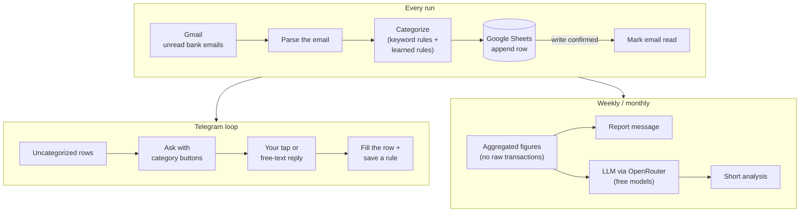

# Monitor Finance

**An expense tracker that runs itself.** It reads the bank's transaction emails from
Gmail, sorts every purchase into a category, writes it to Google Sheets, and asks you on
Telegram about the ones it can't place. You tap a button once, and it remembers the
answer from then on. Every week and month it sends a spending report with a short
analysis written by an LLM.


Built for PrivatBank (Ukraine) notification emails. Bot messages and category names are
in Ukrainian.

---

## What it does

- **No manual entry.** Every card transaction the bank emails about becomes a row:
  date, time, type, category, merchant, amount, balance.
- **Asks only when it has to.** Known merchants are categorized by keyword rules. The
  rest arrive in Telegram as a question with category buttons, or you can just reply in
  your own words ("таксі додому").
- **Learns.** Answering about a merchant writes a permanent rule, so the same shop is
  never asked about twice.
- **Reports that mean something.** Spending is judged against income and the pay cycle,
  not just summed. Repeat charges are flagged as subscriptions, and categories are
  compared with their three-month average.
- **Runs unattended.** One small worker process (or a cron job). No database and no web
  server: the spreadsheet is the storage.

## What it looks like in Telegram

A question about a transaction it couldn't categorize (the text is real output of
`format_question` with sample data; the buttons come from the `Категорії` tab):

```
14.08.2026 19:05  -342.50₴
SHOP ROMASHKA, KYIV
Оберіть категорію:
[ Продукти ] [ Кафе та ресторани ] [ Таксі ] … [ Інше ]
```

After your answers are applied:

```
✅ Категоризовано: 2
• SHOP ROMASHKA, KYIV → Продукти
• Uklon → Таксі
```

From the weekly report, how fast money is going relative to the pay cycle:

```
Спалено 61% доходу, минуло 47% циклу
До надходження 8 дн · тримайтесь 490 ₴/день (зараз 890)
```

## How it works



### Engineering notes

- **Crash-safe and idempotent.** The email's UNREAD label is the work queue: an email is
  marked read only *after* its row is confirmed written, so a failed API call just means
  a retry next run. A `transaction_id` column is the dedup ledger, so nothing is ever
  counted twice.
- **Works on hosts with no disk.** Google credentials can come from environment
  variables, and the bot's state (poll offset, chat id, who was asked what) lives in a
  hidden `_state` tab of the spreadsheet. That's what lets it run on Heroku's ephemeral
  dynos.
- **Long-polling worker.** `worker.py` holds a Telegram long-poll open, so answers are
  applied within seconds and updates never expire in the queue. A `WORKER_ACTIVE` guard
  stops any leftover cron job from competing for the same updates (Telegram allows one
  consumer per bot).
- **Careful with the LLM.** Free-text replies are matched against the local vocabulary
  first, and only something genuinely new is sent to a model. The report model only sees
  finished figures (never raw transactions, ids, balances or names) and is told not to do
  arithmetic. Free OpenRouter models are tried in order with a fallback. Without an
  `OPENROUTER_API_KEY`, everything still works and the analysis is simply left out.
- **Parser edge cases.** Transaction direction when the bank omits the sign, transfers
  between your own cards (not counted as spending), commission folded into the amount,
  foreign-currency purchases, refunds categorized as what they reverse.
- **Alerts.** A failed run or a feed that has gone quiet for 48 hours is reported to
  Telegram, throttled so an outage doesn't spam.

## Tech stack

| | |
|---|---|
| **Language** | Python 3.14, managed with [uv](https://docs.astral.sh/uv/) |
| **Google** | Gmail API (read + label), Sheets API, OAuth 2.0 |
| **Messaging** | Telegram Bot API (long-polling, inline keyboards) |
| **LLM** | OpenRouter (free models, ranked fallback) |
| **Tests** | pytest: 495 tests, no network |
| **Deploy** | Heroku worker dyno + Scheduler, or any machine with cron |

## Setup

```bash
uv sync
```

**1. Google credentials.** Create an OAuth client (Desktop app) with the Gmail and Sheets
APIs enabled and save it as `creds/credentials.json`. The first run opens a browser to
sign in and writes `creds/token.json`, which refreshes itself after that. Publish the
OAuth consent screen: in *Testing* mode Google expires refresh tokens after 7 days.

**2. Environment** (`.env`):

| Variable | Required | What it does |
|---|---|---|
| `SPREADSHEET_ID` | yes | The id from the sheet's URL |
| `TELEGRAM_API` | yes | Bot token from @BotFather. The chat is picked up from your first `/start` |
| `TELEGRAM_CHAT_ID` | for alerts | Where failure and staleness alerts go |
| `OPENROUTER_API_KEY` | no | Enables the LLM analysis and free-text categorization |
| `ACTIVE_START_HOUR` / `ACTIVE_END_HOUR` | no | Active hours; nothing runs outside them (default 05:00–23:00) |
| `DIGEST_HOUR` | no | Earliest hour reports are sent (default 9) |
| `WORKER_ACTIVE` | no | Set when `worker.py` runs, so a cron `main.py` stands down |

**3. Spreadsheet tabs:**

| Tab | Purpose |
|---|---|
| `data` | Transactions, columns `Date, Time, Type, Category, Merchant, Amount, Balance, transaction_id` |
| `Sheet2` | Rules: column A = text to match, column B = category |
| `Категорії` | Category buttons, one per row, in the order shown |
| `_state` | Created automatically and hidden. The bot's state |

## Running

```bash
uv run python worker.py      # production: long-polling worker, answers apply in seconds
uv run python main.py        # one run of the pipeline (for cron)
uv run python digest.py      # send a weekly/monthly report if one is due

uv run python backfill.py          # dry run: recategorize existing rows, print a diff
uv run python backfill.py --apply  # write the changes
```

On a server with cron instead of the worker:

```cron
*/15 * * * * cd /path/to/monitor-finance && TZ=Europe/Kyiv flock -n /tmp/mf.lock uv run python main.py >> ~/mf.log 2>&1
```

Set `TZ`: timestamps are written in local time. [`docs/DEPLOY-HEROKU.md`](docs/DEPLOY-HEROKU.md)
walks through a full Heroku deployment.

## Tests

```bash
uv run pytest -q
```

495 tests, all offline. The fixtures are PrivatBank-format emails with made-up names,
cards and amounts.

## Project layout

| File | Responsibility |
|---|---|
| `worker.py` | Long-polling worker (production entry point) |
| `main.py` | One pipeline run: mail → sheet → Telegram, alerts, digest trigger |
| `gmail_service.py` | Fetches unread mail, parses it, manages the UNREAD label |
| `categories.py` | Category rules, shared by the live pipeline and the backfill |
| `spread_sheet_service.py` | All sheet reads and writes |
| `telegram_client.py` / `telegram_service.py` | Bot API transport / the ask-and-apply loop |
| `telegram_state.py` | Bot state stored in the hidden sheet tab |
| `analytics.py` / `digest.py` | Report numbers / report messages and delivery |
| `openrouter_client.py` | LLM calls and free-model selection |
| `auth_service.py` / `creds_bootstrap.py` | Google OAuth, credentials from env vars |
| `backfill.py` | Recategorize historical rows with the same rules |

## Limitations

- Only PrivatBank's email format is supported.
- Data isn't reconciled against official bank statements.
- A transaction the bank never emailed about can't be detected.

## License

© 2026 Artem Levkovich. All rights reserved. The source is published as a portfolio piece.
If you'd like to use it, get in touch.
